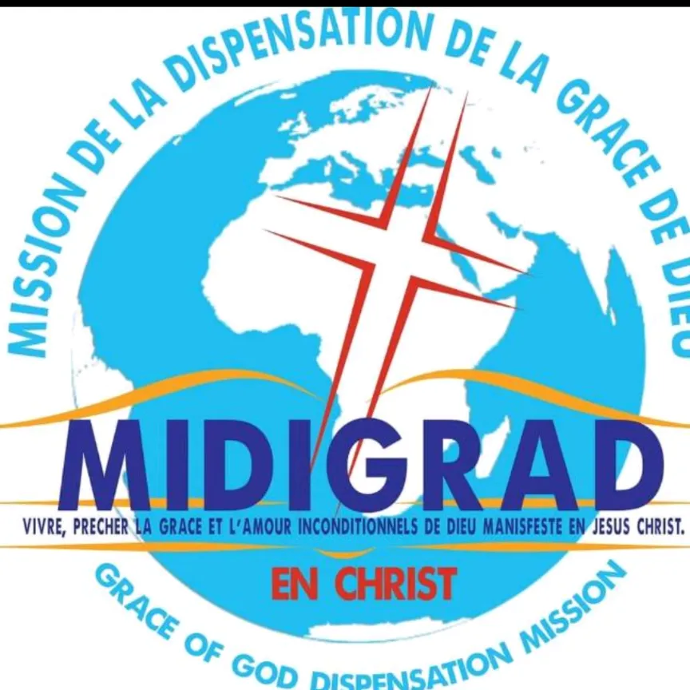

# MIDIGRAD — Espace de communication

**MIDIGRAD** (Mission de la Dispensation de la Grâce de Dieu — *Grace of God Dispensation Mission*)
est une communauté chrétienne basée au Cameroun, conduite par l'Apôtre Paris Talla.
Notre mission : *vivre, prêcher la grâce et l'amour inconditionnels de Dieu manifestés en Jésus-Christ.*

Ce dépôt centralise la communication de l'église sur **TikTok, Instagram, YouTube et Facebook** :
identité visuelle, gabarits, motion design, vidéos et planning éditorial.

## Structure

| Dossier | Rôle |
|---|---|
| [`brand/`](brand/) | Logo, couleurs, polices, [charte graphique](brand/charte.md) |
| [`templates/`](templates/) | Gabarits : verset, citation, annonce de culte, miniature YouTube |
| [`motion/`](motion/) | Animations : intro, outro, versets animés |
| [`videos/`](videos/) | Scripts, sous-titres, notes de montage |
| [`contenus/`](contenus/) | [Système de production](contenus/systeme-production.md) : de la prédication aux publications |
| [`planning/`](planning/) | [Rythme hebdo](planning/rythme-hebdomadaire.md), [check-list](planning/checklist-publication.md), [calendrier](planning/modele-calendrier.md) |
| [`CLAUDE.md`](CLAUDE.md) | Contexte, formats, nommage et règles pour l'assistant IA |

## Mode d'emploi

1. **Avant de créer** : lire `brand/charte.md` (couleurs, polices, logo).
2. **Après chaque culte** : remplir une fiche dans `contenus/predications/` à partir du modèle.
3. **Produire** : suivre `contenus/systeme-production.md` (1 vidéo longue, 3–5 extraits, visuels de versets, 1 post Facebook).
4. **Planifier** : remplir le calendrier du mois dans `planning/calendrier/`.
5. **Publier** : cocher `planning/checklist-publication.md` — versets et paroles de l'Apôtre toujours vérifiés.
6. **Nommer** chaque fichier `AAAA-MM-JJ_type_titre` (ex. `2026-10-18_verset_la-grace-suffit.png`).

Les fichiers lourds (rushs, rendus vidéo) restent sur le Drive de l'équipe ; seul le lien est noté ici.
